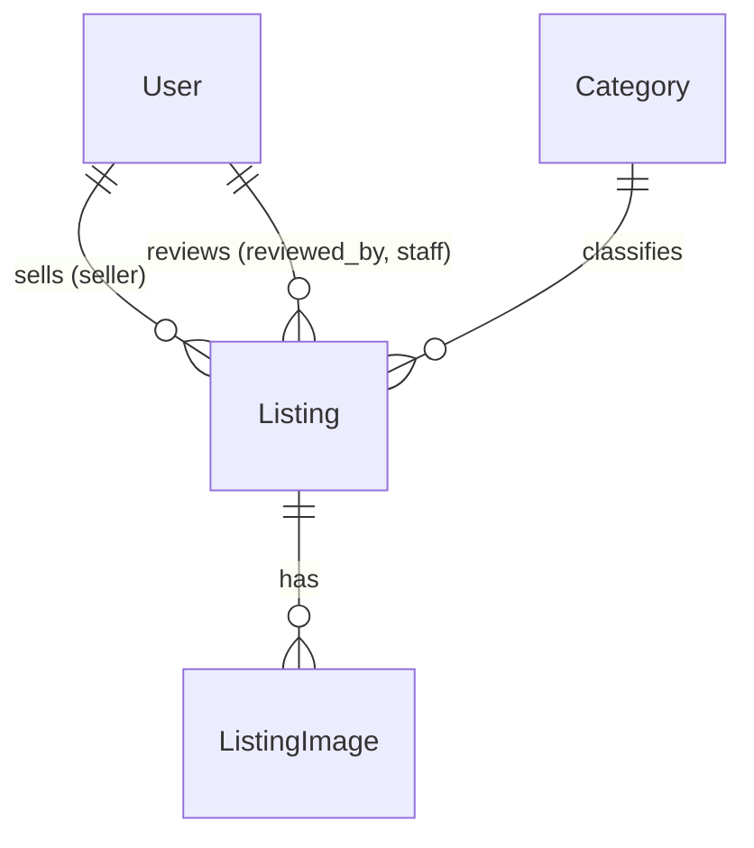
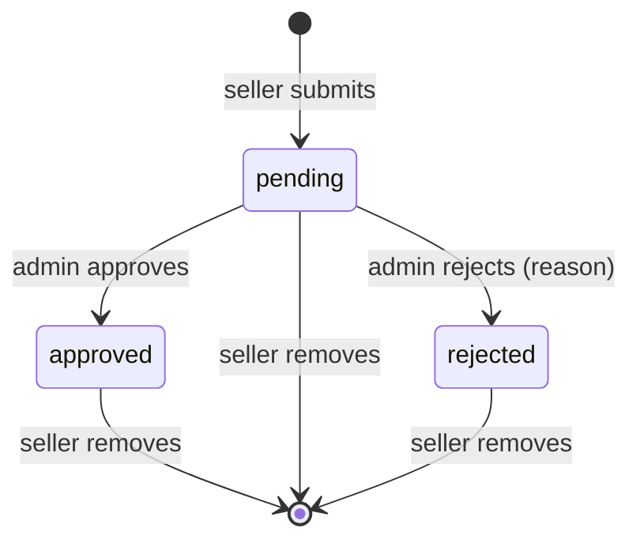

# Database design (SQLite, Django ORM)

Three apps: `accounts` (User), `catalog` (Category, Listing, ListingImage). Four tables.

## accounts.User (custom, `AUTH_USER_MODEL`)

One table serves both the admin-provisioned roster and the login account. Admin creates the row; the student later *claims* it (see [auth-flow.md](auth-flow.md)).

| Field | Type | Notes |
|---|---|---|
| id | BigAuto PK | |
| full_name | Char(150), blank | set by admin; empty for the admin account |
| university_id | Char(20), **unique, null** | UAP student ID, set by admin |
| phone | Char(20), **unique, null** | digits only, set by admin; shown on the seller's listings |
| status | Char choices | `active` / `inactive` / `banned`, admin-set. Only `active` can register or log in |
| email | Email, **unique, null** | set by admin; `USERNAME_FIELD`; matched at registration |
| password | Char | unusable until registration |
| registered_at | DateTime null | set on claim; null = student has not registered yet |
| is_staff / is_superuser / is_active | Bool | Django admin plumbing; `is_active` is true only when `status = active` |
| created_at | DateTime | |

Rules: only `active` students can log in. The `.env` admin has only email + password; its university_id and phone stay null (SQLite allows many NULLs in a unique column).

## catalog.Category

| Field | Type | Notes |
|---|---|---|
| name | Char(80), unique | |
| slug | Slug, unique | |
| is_active | Bool | inactive hidden from new-listing form; old listings keep it |
| sort_order | Int | |

Flat list (no parent/child) for v1. Admin-only writes.

## catalog.Listing

| Field | Type | Notes |
|---|---|---|
| seller | FK User, PROTECT | |
| category | FK Category, PROTECT | required |
| title | Char(120) | |
| description | Text | |
| listing_type | choices | `sell` / `exchange` / `rent` / `donate` (free, no price; "mark donated" reuses is_sold) |
| price | Decimal(10,2) null | required for sell and rent; BDT |
| rent_period | choices null | `day` / `week` / `month`, required for rent |
| exchange_for | Char(200) blank | what the seller wants back, for exchange |
| condition | choices | `new` / `like_new` / `good` / `fair` |
| status | choices | `pending` / `approved` / `rejected`; default `pending` |
| is_sold | Bool | default false; seller sets it from My listings. Sold listings stay visible with a Sold badge and hide the seller contact |
| reject_reason | Text blank | shown to seller |
| reviewed_by | FK User null | staff |
| reviewed_at | DateTime null | |
| created_at / updated_at | DateTime | |

Constraints (CheckConstraint): sell/rent ⇒ price not null; rent ⇒ rent_period not null.
Indexes: `(status, -created_at)` for the public feed, `(category, status)`, `(seller)`.

## catalog.ListingImage

| Field | Type | Notes |
|---|---|---|
| listing | FK Listing, CASCADE | |
| image | ImageField | `media/listings/<listing_id>/<uuid>.<ext>` on local disk |
| position | Int | 0 = cover |

Limit (e.g. 5 per listing, ≤ 5 MB each) enforced in the form, not the DB.

## catalog.BuyRequest

| Field | Type | Notes |
|---|---|---|
| listing | FK Listing, CASCADE | |
| buyer | FK User, CASCADE | one request per buyer per listing |
| amount | Decimal(10,2) null | what the buyer offers; required for sell and rent |
| status | choices | `pending` / `accepted`; seller accepts, which also sets the listing sold |

The seller contact is shown to a buyer only after they have a request. The seller sees buyer name, phone and amount on the requests page.

## inbox.Message

| Field | Type | Notes |
|---|---|---|
| buy_request | FK BuyRequest, CASCADE | the conversation: one chat per buyer per item |
| sender | FK User, CASCADE | the buyer or the item's seller |
| text | Text(1000) | |
| created_at | DateTime | |

Only the buyer and the item's seller can open or post to a conversation; anyone else gets 404.

## reviews.Review

| Field | Type | Notes |
|---|---|---|
| listing | FK Listing, CASCADE | |
| reviewer | FK User, CASCADE | one review per buyer per listing |
| rating | Int | 1 to 5 |
| comment | Text blank | |
| status | choices | `pending` / `approved` / `rejected`; default `pending`. Only approved reviews are public; the reviewer sees their own pending one with a notice |

Only a buyer whose request was accepted (verified buyer) can review. Admin approves in Django admin (list filter + Approve action).

## Listing lifecycle

- Only `approved` is public. Enforce via one custom manager, `Listing.objects.public()`; no view filters on status by hand.
- **No editing** in v1. To change something, the seller removes the listing and posts a new one (it goes through approval again).
- **Remove = delete** the row and its image files from disk. Sold/rented items are simply removed.
